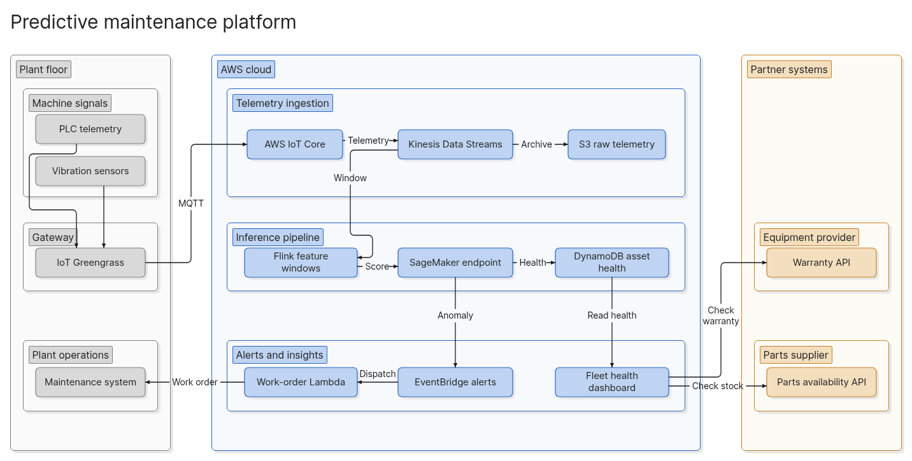
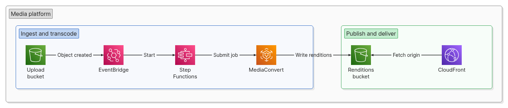
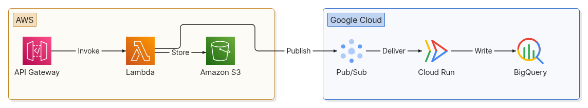

# CloudDraft

CloudDraft renders cloud architecture diagrams from text files on your machine. Define services, group them into system boundaries, and label how they connect. Export a PNG for documentation or a standalone HTML file to open in a browser.

## Examples

### Predictive maintenance platform

An AWS reference design that follows machine telemetry from the plant floor through ingestion, scoring, and work-order dispatch. It also shows where fleet dashboards and partner APIs fit.

[](docs/images/predictive-maintenance.png)

[Editable JSON source](examples/predictive-maintenance.json). The node coordinates preserve the three-zone layout. After building CloudDraft, regenerate the PNG with:

```sh
CHROMIUM_PATH=/usr/bin/chromium node packages/diagrams-cli/dist/cli.js render examples/predictive-maintenance.json -o exports/predictive-maintenance.png
```

### AWS media pipeline

An S3 upload starts a Step Functions workflow through EventBridge. MediaConvert writes the encoded renditions to S3, and CloudFront serves them from that bucket.

[](docs/images/media-pipeline.png)

[Diagram source](examples/media-pipeline.eraserdiagram)

### AWS to Google Cloud event pipeline

A Lambda function invoked by API Gateway stores data in S3 and publishes an event to Pub/Sub. Cloud Run processes the event and writes to BigQuery.

[](docs/images/multi-cloud.png)

[Diagram source](examples/multi-cloud.eraserdiagram)

## Quick start

Install Node.js 24.22.1, Corepack, and Chromium. From the repository root, run:

```sh
corepack pnpm install --frozen-lockfile
corepack pnpm build
corepack pnpm architecture examples/media-pipeline.eraserdiagram
```

The command creates `exports/media-pipeline.png` and `exports/media-pipeline.html`. Pass a second argument to set a different export directory. Set `CHROMIUM_PATH` if your browser executable is somewhere other than `/usr/bin/chromium`.

The AWS and Google Cloud icons are included in `icons/cloud/`. Look up service names in `icons/cloud/catalog.json`. Rendering uses local files after setup. To refresh the catalog from [Eraser’s icon catalog](https://docs.eraser.io/icons), run `corepack pnpm icons:cloud` with curl and internet access.

## Write a diagram

Save the following as `service.eraserdiagram` and run `corepack pnpm architecture service.eraserdiagram`.

```text
cloud-architecture-diagram
direction right

Application [color: blue] {
  Gateway [icon: aws-api-gateway]
  Worker [icon: aws-lambda]
}

Gateway > Worker: Invoke
```

CloudDraft supports nested groups, local SVG icons, labeled connections, and left-to-right or top-to-bottom placement. The CLI places nodes in declaration order and routes connectors automatically. PNG and HTML exports are static.

Use one statement per line and declare both ends of a connection. Supported
connectors are `>`, `<`, `<>`, and `--`. Put custom SVGs in `icons/` or set
`ARCHITECTURE_ICONS` to point at another directory. Custom icons take precedence
over the bundled catalog.

For exact node coordinates, see the [JSON diagram guide](docs/GETTING_STARTED.md).
For custom components and styling, see [Customization](docs/CUSTOMIZATION.md).

## Credits and license

CloudDraft uses the MIT-licensed [Eraser Diagrams](https://github.com/eraserlabs/eraser-diagrams) engine. See [LICENSE](LICENSE).
